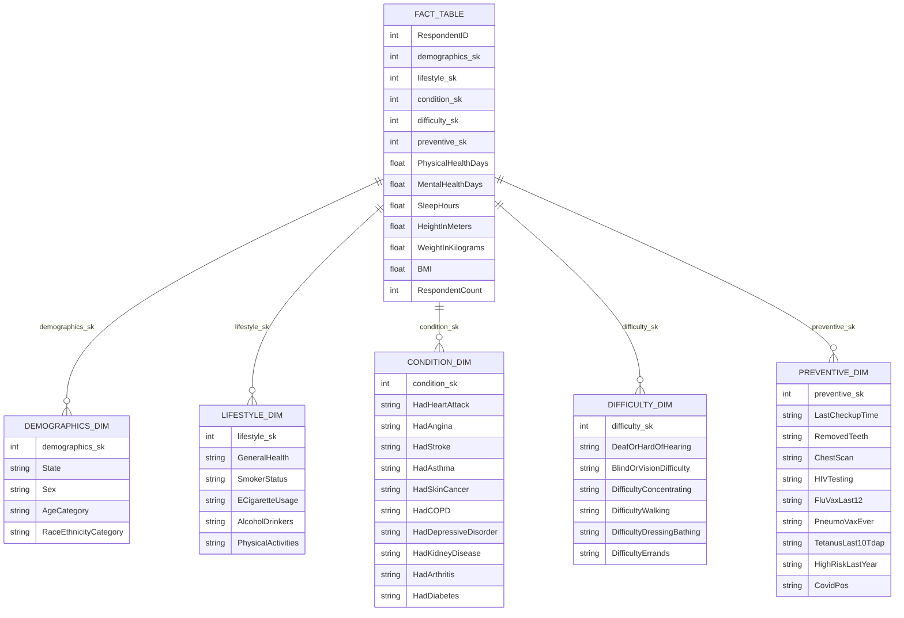
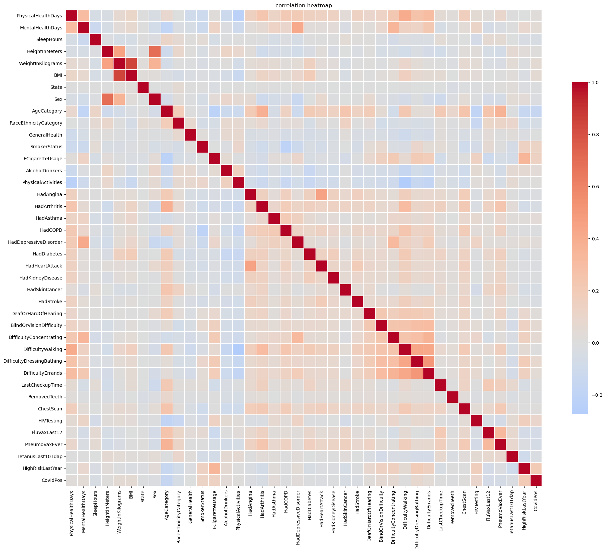

# Heart Survey ETL with Pentaho (Star Schema)

This project takes the raw BRFSS 2022 heart disease survey file and turns it into a star schema with Pentaho Data Integration (Kettle). After that I join the tables back together in Python to check that the result can be used for machine learning.

It was a group project at BINUS University. I designed and built the Pentaho pipeline.

## Data

The dataset is "Personal Key Indicators of Heart Disease" on Kaggle (the 2022 version, file `heart_2022_with_nans.csv`):
https://www.kaggle.com/datasets/kamilpytlak/personal-key-indicators-of-heart-disease

It has 445,132 rows and 40 columns, with a lot of missing values. The data is not in this repo. Download it and put it in the `data` folder.

## Star schema



There is one fact table with one row per respondent (445,132 rows) and five dimension tables:

| Table | Rows |
|---|---|
| demographics_dim | 8,593 |
| lifestyle_dim | 1,011 |
| condition_dim | 5,004 |
| difficulty_dim | 501 |
| preventive_dim | 8,578 |

Each dimension only keeps the unique combinations of its columns, so no respondent is dropped. The fact table holds the five surrogate keys, the numeric measures (physical health days, mental health days, sleep hours, height, weight, BMI) and `RespondentCount`, which is always 1 so it can be summed.

## Pipeline

The transformation is in `pentaho/data_engineering_revisi.ktr` and the job that runs it is in `pentaho/Job_data_engineering.kjb`.

1. Read the CSV and select the 40 columns.
2. Add a sequence to create `RespondentID`.
3. Split the stream into five branches, one per dimension, each with only its own columns.
4. In each branch, sort the rows, keep the unique ones and add a sequence as the surrogate key. Each dimension is written to its own CSV.
5. The main stream goes through a Blocking step, so it waits until the dimension branches are ready.
6. Five Stream Lookup steps in a row attach the surrogate keys to every respondent.
7. Add the `RespondentCount` constant, keep the keys and measures, and write `fact_table.csv`.

I checked the output after running it: the fact table has no empty surrogate keys, and the row count is the same as the input (445,132).

## Using it for machine learning

`heart_attack_model.ipynb` reads the six CSV files and joins them back into one table (445,132 rows and 47 columns). Then it does this:

- Keeps the rows where `HadHeartAttack` is Yes or No (442,067 rows).
- Fills missing values. BMI is calculated from height and weight where possible. Height, weight and BMI use the median of the same sex and age group. Day and sleep counts use the median. Missing categories become "Unknown".
- Keeps the 32 features whose correlation with the target is at least 0.02 in absolute value.
- Trains a HistGradientBoostingClassifier with SMOTE (oversampling inside the pipeline, so it only touches training data).
- Picks the classification threshold on a validation set, then checks it once on the test set (70 / 15 / 15 split).



Results:

- 3-fold cross-validation ROC-AUC: 0.887
- Test ROC-AUC: 0.888
- At the chosen threshold (0.25), for people who had a heart attack: recall 0.532, precision 0.443, F1 0.483

Only about 6% of respondents in the test set had a heart attack, so with the default threshold recall is low (0.31 in cross-validation). Lowering the threshold finds more cases but also gives more false alarms.

## Run it

1. Download the dataset and put it in `data/`.
2. Open `pentaho/data_engineering_revisi.ktr` in Spoon. The file paths inside are from my computer (`C:\Users\Lenovo\...`), so change the CSV input path and the six output paths to your `data` folder.
3. Run the transformation, or run the job after pointing it to the transformation.
4. Install the Python packages and open the notebook:

```
pip install -r requirements.txt
jupyter notebook heart_attack_model.ipynb
```

Tools: Pentaho Data Integration, Python, pandas, scikit-learn, imbalanced-learn, Matplotlib, Seaborn.
